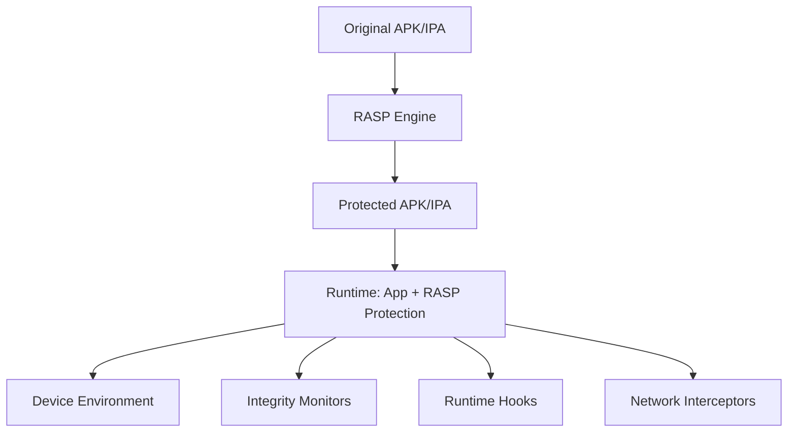

# RASP Architecture, Modes & 2026 Trends

**Technical deep dive: integration models, protection layers, detection modes, and emerging AI-driven threats**

Your mobile application runs in hostile environments. Every device it installs on could be rooted, jailbroken, hooked, debugged, or running inside an emulator. Traditional perimeter defenses (WAFs, network firewalls, API gateways) see none of this. They operate outside the application, blind to the runtime context where attacks actually execute.

Runtime Application Self-Protection (RASP) changes this equation. It integrates protection inside the application's runtime, giving it contextual visibility into the device environment, application integrity, runtime state, and network layer. Think of it as an immune system that travels with your app, rather than a castle wall that stays behind.

In 2026, this distinction matters more than ever. AI-driven automation, deepfake-based social engineering, and the rise of hybrid frameworks (Flutter, React Native, Kotlin Multiplatform) have expanded the mobile attack surface. RASP isn't a silver bullet, but for high-value applications (fintech, healthcare, government), it has become a necessary layer in a defense-in-depth strategy.

---

## What Is RASP?

Runtime Application Self-Protection is a security technology that instruments an application at build time or via SDK integration, embedding detection and prevention capabilities directly into the application binary. Unlike perimeter defenses that inspect traffic en route to the application, RASP operates within the application process with full visibility into:

- **Device environment**: root/jailbreak status, emulator artifacts, SELinux state, verified boot
- **Application integrity**: binary modifications, resource tampering, DEX/Mach-O checksums, signature verification
- **Runtime state**: attached debuggers, hooked functions, injected code, loaded frameworks (Frida, Xposed, LSPosed, Substrate)
- **Network layer**: MITM proxies, invalid certificates, user-installed CAs, certificate pinning violations



The key differentiator is **contextual visibility**. A WAF sees an HTTP request. RASP sees that request originating from a hooked function on a rooted device with a debugger attached. That context changes the risk calculus entirely.

---

## Integration Models

RASP solutions generally follow one of three integration patterns:

### Build-Time Fusion (Most Common)

```
Original APK → RASP Build Engine → Protected APK
                  (injects .so libs,
                   modified DEX/bytecode,
                   new classes, integrity checks)
```

- **How it works**: The original application binary is processed through a build pipeline that injects native libraries, modified bytecode, additional classes, and integrity verification logic. No source code changes required.
- **Pros**: Zero developer effort, automatic initialization, consistent coverage
- **Cons**: Black-box behavior, harder to debug, build pipeline dependency

### SDK Integration

```
Source Code → Add RASP Dependency → Build APK
                 (manual init in Application class)
```

- **How it works**: Developers add the RASP SDK as a dependency and initialize it programmatically (typically in a custom `Application` subclass).
- **Pros**: Control over initialization timing, programmable configuration, feature flags
- **Cons**: Developer effort required, maintenance overhead, potential for initialization gaps (some implementations provide Gradle plugins, auto-configuration, or wrapper libraries that reduce boilerplate)

### Hybrid Approach

- Build-time fusion provides baseline protection (integrity, anti-tamper, core detectors)
- SDK layer exposes runtime APIs for custom decisions: risk reporting to backend, dynamic policy updates, custom kill-switch logic
- Best of both worlds, highest complexity

### Integration Model Comparison

| Model | Developer Effort | Initialization | Debugging | Flexibility | Best For |
|-------|------------------|----------------|-----------|-------------|----------|
| Build-Time Fusion | None | Automatic | Difficult | Low | Rapid deployment, no code changes allowed |
| SDK Integration | Medium | Manual | Easier | High | Teams needing runtime control, feature flags |
| Hybrid | Medium-High | Automatic + Manual | Moderate | Highest | Enterprise requiring both baseline and custom logic |

---

## Core Protection Layers

A mature RASP implementation typically covers these seven detection categories:

| Layer | Detection Targets | Bypass Difficulty |
|-------|-------------------|-------------------|
| **Root / OS Integrity** | `su` binary, Magisk, KernelSU, BusyBox, SELinux permissive, verified boot failure, system partition RW | Low–Medium |
| **Hooking Frameworks** | Frida, Xposed, LSPosed, Dobby, Substrate, Cydia Substrate | Medium–High |
| **Debugger Detection** | `ptrace`, JDWP, `TracerPid`, `gdb`/`lldb` attachment, hardware breakpoints | Low |
| **Emulator Detection** | QEMU artifacts, build.prop anomalies, BlueStacks, Windows Subsystem for Android, Genymotion | Low–Medium |
| **Tampering / Integrity** | APK signature verification, DEX checksums, resource hashes, native library integrity | Medium–High |
| **Certificate Pinning** | MITM proxies, invalid cert chains, user-installed CAs, custom TrustManager/NSURLSession delegates | Medium |
| **Repackaging Detection** | Re-signed binaries, modified resources, injected code, wrapper detection | High |

> **Note**: "Bypass Difficulty" reflects the effort required by a skilled attacker with modern tooling. No layer is impenetrable; the goal is raising the cost beyond the attacker's ROI.

---

## Detection vs. Prevention: Operational Modes

RASP solutions operate on a spectrum from passive observation to active enforcement:

| Mode | Behavior | Bypass Implication |
|------|----------|-------------------|
| **Monitor Only** | Logs/reports detection events; application continues normally | No bypass needed: app functions unimpeded |
| **Soft Block** | Shows warning (toast, dialog, custom UI); user can acknowledge and continue | Attacker bypasses warning UI or suppresses the callback |
| **Hard Block** | Terminates app process, displays block screen, prevents further execution | Attacker must fully evade detection before the check executes |
| **Backend Reporting** | Sends device risk score, detection events, and telemetry to server; server enforces policy | Attacker must also spoof risk signals to backend (or compromise the channel) |

Most production deployments combine modes: **Monitor** for low-signal detectors, **Soft Block** for medium-risk findings, **Hard Block** for high-confidence critical detections (e.g., active Frida session), and **Backend Reporting** for risk-based authentication and fraud decisions.

---

## Android vs. iOS: Key Differences

The threat model is similar; the detection surface differs significantly:

| Aspect | Android | iOS |
|--------|---------|-----|
| **Root / Jailbreak** | `su`, Magisk, KernelSU, test-keys, patched boot images | Cydia Substrate, unc0ver, checkra1n, palera1n, Dopamine, rootless vs rootful |
| **Integrity Verification** | APK signature (v1/v2/v3/v4), DEX checksums, `Play Integrity API` | Mach-O signature, `FairPlay` DRM, `App Attest`, code signing enforcement |
| **Hooking Frameworks** | Frida, Xposed, LSPosed, Dobby | Frida, Substrate, CydiaSubstrate, SwiftTweaks |
| **Certificate Pinning** | `NetworkSecurityConfig`, `OkHttp` `CertificatePinner`, custom `TrustManager` | `ATS` (App Transport Security), `NSURLSession` delegate pinning, `Alamofire`/`TrustKit` |
| **Runtime Access** | Full filesystem, `/proc` inspection, `ptrace`, `netstat`, `lsof` | Sandboxed, restricted `/proc`, no `ptrace` without entitlement, limited process introspection |
| **Anti-Debugging** | `ptrace(PTRACE_TRACEME)`, `TracerPid`, `/proc/self/status`, `JDWP` | `ptrace(PT_DENY_ATTACH)`, `sysctl(KERN_PROC)`, `kern.proc.pid` |
| **Emulator/Simulator** | QEMU props, Goldfish pipes, WSA, BlueStacks artifacts | Xcode Simulator detection, private framework checks, hardware model validation |

**Practical implication**: Android RASP has more telemetry sources (filesystem, `/proc`, process listings) but faces a more fragmented ecosystem (OEM modifications, custom ROMs, kernel variants). iOS RASP operates in a tighter sandbox with fewer signals but more consistent hardware/software baselines.

---

## 2026 Trends: Where RASP Is Heading

### ML/Behavioral Analysis On-Device

Traditional RASP relies on signature-based detection (known Frida artifacts, known Magisk paths). 2026 sees a shift toward **on-device behavioral models**:

- **Touch/gesture analytics**: velocity, pressure, angle, swipe patterns to distinguish human vs. automation
- **Sensor fusion**: accelerometer, gyroscope, magnetometer correlations for device authenticity
- **Typing dynamics**: keystroke timing, flight time, dwell time for continuous authentication
- **Advantage**: Detects novel automation frameworks without signature updates; reduced false positives via continuous learning of legitimate user behavior

### Generative AI Application Protection

As mobile apps integrate LLMs (chatbots, KYC document processing, code generation, summarization), new attack vectors emerge:

- **Prompt injection detection**: monitoring input/output for instruction override attempts
- **KYC/identity manipulation**: detecting synthetic document generation, deepface injection in onboarding flows
- **Inference integrity**: verifying on-device model weights haven't been swapped (quantized model tampering)
- **Data exfiltration via AI**: detecting when model outputs encode sensitive data through steganographic means

### Emerging 2026 Protection Layers

| Layer | Threat Addressed |
|-------|------------------|
| **Biometric & Presentation Attack Detection** | Face/fingerprint spoofing via injection, deepfakes, presentation attacks (prints, masks, screens) |
| **Screen Privacy & Content Protection** | Unauthorized screen capture, screen-sharing, remote desktop/VNC, accessibility services reading screen |
| **Overlay & Accessibility Abuse Detection** | Malicious overlays, tapjacking, accessibility misuse for transaction manipulation, known malware families |
| **Remote Access & Control Detection** | Unauthorized remote control sessions (RDP, VNC, remote support tools) during sensitive operations |
| **Automation & Non-Human Interaction Detection** | Scripted inputs, replay attacks, bot farms, emulator/automation frameworks at scale |

These layers reflect the convergence of **mobile malware**, **social engineering**, and **AI-enabled fraud**: threats that perimeter defenses cannot see because they occur inside the user session.

### Hybrid Framework Support

Modern apps increasingly use cross-platform frameworks, each with unique protection challenges:

- **Flutter**: protecting `libapp.so` (compiled Dart), verifying `flutter_assets/` integrity, detecting `dart:ffi` tampering
- **React Native**: `index.android.bundle` / `main.jsbundle` integrity, Hermes bytecode verification, JSI bridge monitoring
- **Kotlin Multiplatform**: shared native module protection, `expect`/`actual` implementation integrity, CInterop boundary validation

RASP engines must now understand framework-specific structures, not just platform-native binaries.

---

## When Does RASP Make Sense?

### Strong Fit

- **High-value transactions**: Banking, payments, crypto, trading, where device compromise equals direct financial loss
- **Regulatory pressure**: PCI DSS (requirement 6.5.6), PSD2/SCA, GDPR (data protection by design), banking regulations (SBIF, CNBV, BACEN)
- **Intellectual property**: Proprietary algorithms, DRM-protected content, trade secrets in mobile clients
- **Fraud-prone onboarding**: KYC, biometric enrollment, document verification flows

### Limitations to Acknowledge

- **Not a silver bullet**: Sophisticated attackers will bypass given time and motivation (kernel-level root, custom ROMs, hardware-backed attestation spoofing)
- **Performance overhead**: Native library injection, integrity checks on startup, runtime hooks; measurable impact on cold start and memory
- **Maintenance burden**: OS updates (Android 15/16, iOS 18/19), new emulator versions, evolving hooking frameworks require continuous RASP updates
- **False positives**: Legitimate users on custom ROMs, developers with debug builds, and accessibility service users can trigger blocks. These scenarios require tuning or allowlisting to avoid friction for valid users.

### Decision Framework

> **If your threat model assumes the device may be compromised, and the cost of a successful attack exceeds the cost of RASP deployment + maintenance + false positive handling, you need RASP.**

If you're protecting a content-reading app with no transactions, no PII, no regulatory mandate, RASP is likely over-engineering.

---

## The False Positive Problem

False positives are not just an annoyance; they undermine the entire RASP value proposition:

- **User abandonment**: Legitimate users blocked during critical flows (payments, onboarding, authentication) churn immediately. Mobile users have zero tolerance for security that breaks their task.

- **Support overload**: Each false block generates tickets, refunds, chargebacks, and reputation damage. The cost of handling false positives often exceeds the cost of the attacks RASP prevents.

- **Security theater**: Teams under pressure to reduce false positives lower detection sensitivity or disable detectors entirely. A RASP tuned to never false-positive detects nothing.

- **Erosion of trust**: When security teams cry wolf repeatedly, stakeholders stop believing real alerts. The next critical detection gets ignored.

- **Regulatory exposure**: In regulated industries (banking, healthcare), blocking legitimate users can violate accessibility laws (ADA, EAA), anti-discrimination regulations, or consumer protection mandates.

The goal is not zero false positives; it is manageable false positives with clear triage paths, allowlisting workflows, and gradual rollout (canary to phased to full). If you cannot operationalize the alerts, the RASP becomes shelfware.

---

## Final Verdict

RASP is fundamentally a **runtime immune system**. It doesn't prevent the device from being compromised; it ensures your application knows when it's running in a compromised environment and can respond accordingly: whether that's logging, warning, blocking, or escalating to a backend risk engine.

The 2026 reality: attackers use AI, deepfakes, and kernel-level tooling. Defenders need behavioral detection, GenAI-aware protections, and framework-specific integrity verification. RASP solutions that treat this as a signature-matching game will fall behind.

For security teams evaluating RASP: **start with architecture mapping, not vendor demos**. Map your threat model to the seven protection layers. Identify which detectors must be hard-block vs. monitor-only. Define your backend risk integration requirements. Then evaluate solutions against your requirements.

The best RASP deployment is the one aligned to your specific risk, not the one with the longest feature list.

---

*This is not a sponsored post.*